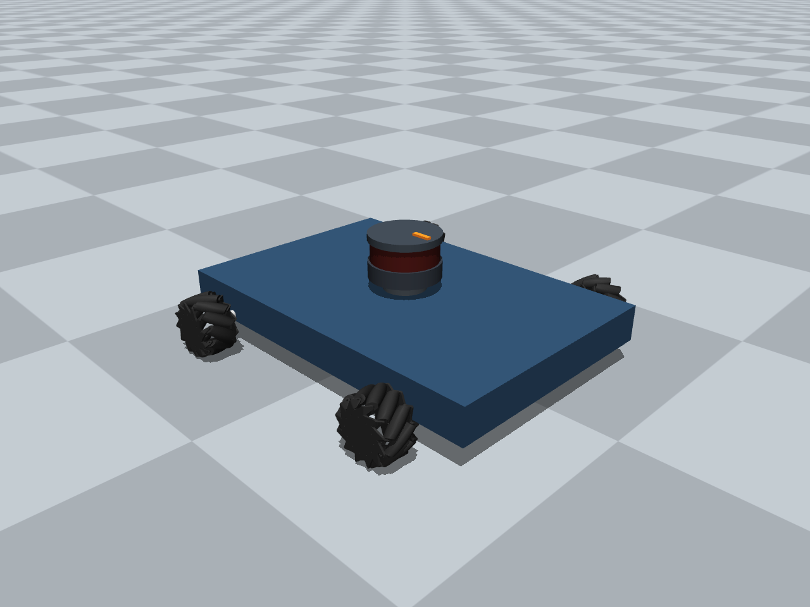

# 自定义麦克纳姆四轮模型

模型入口是 [robots/mecanum.xml](robots/mecanum.xml)，运行入口是 [test.py](test.py)。轮径、轮宽、轴距和轮距采用提供的实物尺寸，质量、惯量和驱动参数采用适合当前尺寸的仿真估计值。

车轮通过短水平轴直接安装在底盘两侧，轮心比车身中心低 `1 cm`，采用参考图中的紧凑布局，底盘名义离地间隙为 `2 cm`。

场景使用低对比的浅灰／灰蓝棋盘格、哑光材质和中性光照。每个格子约 `0.10 × 0.10 m`，便于判断位移，也让深色车轮更清楚。棋盘只是纹理，地面仍是平整的碰撞平面。

车顶中央新增原生二维激光雷达，提供 `360°`、`1°` 角分辨率的测距数据；可选障碍物场景用于观察扫描效果。



[查看俯视图](images/mecanum_top.png)

## 尺寸与坐标基准

| 参数 | 数值 |
| --- | --- |
| 车身长 × 宽 × 厚 | `0.30 × 0.20 × 0.03 m` |
| 车身总成质量 | `6 kg`，作为车架、电池、控制器、固定电机与载荷的等效集中质量 |
| 车身几何中心相对 `base_link` | `(0, 0, 0) m` |
| 车轮外径 × 轮宽 | `0.05 × 0.03 m` |
| 前后轮中心距（轴距） | `0.20 m` |
| 左右轮中心距（轮距） | `0.25 m` |
| 单轮主体质量 | `0.108 kg`，不含可独立转动的滚子 |
| 单个滚子质量 | `0.001 kg`，每轮 12 个 |
| 单个完整车轮质量 | `0.120 kg = 0.108 + 12 × 0.001 kg` |
| 雷达与安装座质量 | `0.150 kg`，安装在车身上方中央 |
| 整车总质量 | `6.630 kg`，含车身、四轮、48 个滚子及雷达 |
| 底盘离地间隙 | 名义 `0.020 m`，静置验证约 `0.01993 m` |

`base_link` 是带自由关节的根刚体，坐标方向为 **X 向前、Y 向左、Z 向上**。原点位于车身盒子中心，所有轮心相对它的 `z=-0.01 m`。地面为世界坐标 `z=0`，不与 `base_link` 原点重合。

| 车轮 | 相对 `base_link` 的轮心位置（m） |
| --- | --- |
| 左前 `front_left` | `(0.10, 0.125, -0.01)` |
| 右前 `front_right` | `(0.10, -0.125, -0.01)` |
| 左后 `back_left` | `(-0.10, 0.125, -0.01)` |
| 右后 `back_right` | `(-0.10, -0.125, -0.01)` |

模型初始世界位置为 `base_link.pos = (0, 0, 0.036)`，轮心世界高度为 `0.026 m`，使半径 `0.025 m` 的车轮从距地面约 `1 mm` 的位置自然落地。静置后 `base_link` 世界高度约 `0.03493 m`。

车身几何原来的 `z=0.15 m` 偏置和四根长斜支架已移除。现在仅将轮轴放在车身中心下方 `1 cm`，短水平轴仍直接连接底盘侧面与轮子内侧。这样将底盘离地间隙从约 `1 cm` 提高到 **`2 cm`**，同时保持 `5 cm` 轮径、低重心和紧凑安装方式。离地间隙不等于越障高度；它仍是适合较平整室内地面的模型。

质量与离地高度是当前尺寸下的折中方案：每轮 `120 g` 是小型轮毂与滚子的合理仿真起点，车身总成 `6 kg` 允许包含电池、电机及载荷，加装雷达后四轮静态平均承载约 `1.66 kg/轮`。这些值没有经过称重或材料标定；电机固定部分的质量已计入车身总成，不重复计入旋转车轮。

四个车轮仍各有一个驱动转动关节，用于独立旋转。MJCF 的关节定义的是父子刚体间的运动约束，不要求用额外的长杆连接。

## 模型完善内容

- 将自由关节直接放在 `base_link`，所有轮心位置都以此为基准；移除原来仅作为额外包装的 `base_footprint` 刚体。
- 根据实物轮径和轮宽分别缩放两个车轮 STL 外观，取消无关的底盘和支架网格注册。
- 用每轮 12 个椭球滚子近似接触，替换原来的大球体；每个滚子有沿自身长轴的被动转动关节。椭球半轴为 `0.005 / 0.005 / 0.015 m`，滚子中心距轮轴 `0.020 m`，名义车轮外半径为 `0.025 m`。
- 相邻轮的滚子转轴倾斜方向相反，同一对角线方向相同；按 X 型安装验证前进、横移和原地转向。
- 按新的车轮质量和尺寸重算轮体惯量；滚子惯量按其质量和椭球尺寸设置，并同步降低关节阻尼与附加转动惯量。
- 轮子网格仅显示；碰撞几何独立放在 `group=3`。默认碰撞掩码允许机器人与地面接触，关闭机器人内部的几何碰撞。
- 增加 `1 ms` 时间步、`implicitfast` 积分器和明确的接触参数；接触时间常数为 `0.005 s`。
- 增加四个力矩电机，输入范围 `[-0.25, 0.25] N·m`；这属于演示配置，尚无实物电机参数。轮速比例增益为 `0.05 N·m/(rad/s)`。
- 增加四路轮速、底盘位置/姿态、局部线速度、角速度及加速度传感器。IMU 参考点在车身几何中心。

滚子接触是物理近似，没有精确复刻 STL 中每个滚子的曲面。轮体惯量采用等效实心圆柱近似，滚子质量、惯量和相对轮轴的平移贡献由 MuJoCo 分别计算，完整车轮质量没有重复计入。

## 启动与控制

当前机器的 `py3_11` Conda 环境已安装 MuJoCo，已在 **MuJoCo 3.10.0** 验证。从项目根目录启动：

```powershell
conda activate py3_11
python my_model/test.py

# 使用 XML 中定义的 tracking 相机
python my_model/test.py --camera tracking
```

默认先静置 1 秒，再依次前进、左移、后退、右移、逆时针转向、顺时针转向，最后停下；总仿真时长 23 秒。关闭窗口也可退出。

指定车体速度时，`vx`、`vy` 单位为 `m/s`，`wz` 单位为 `rad/s`；它们始终相对当前车体坐标系：

```powershell
# 向前运动；未指定的速度分量为零
python my_model/test.py --vx 0.04 --duration 8

# 左移，无窗口验证
python my_model/test.py --headless --vy 0.04 --duration 4

# 逆时针原地转向
python my_model/test.py --wz 0.3 --duration 5
```

模型文件通过脚本自身路径定位，也可以进入 `my_model` 后执行 `python test.py`。

控制器根据模型中的轮心位置和 `wheel_radius` 自定义数值计算逆运动学，按名称查找关节和执行器。轮速目标与实际轮速的比例反馈产生电机力矩；目标轮速超过 `20 rad/s` 时同比例缩放，再执行力矩限幅。控制量在 `mj_step()` 前写入。

按 `[左前, 右前, 左后, 右后]` 顺序，当前逆运动学为：

```text
wheel_speed = (1 / 0.025) ×
    [ vx - vy - 0.225*wz,
      vx + vy + 0.225*wz,
      vx + vy - 0.225*wz,
      vx - vy + 0.225*wz ]
```

这是轮速闭环，不是底盘位置或速度闭环；轮子阻尼、滚子接触和地面摩擦会产生跟踪偏差。若后续改变安装方向，还需同步核对逆运动学符号。

## 二维激光雷达

雷达固定在车顶中央，`lidar_link` 相对 `base_link` 的位置为 `(0, 0, 0.045) m`，朝向与车身一致。选择中央安装是为了避免偏置带来的额外坐标换算；扫描平面高于车身、轮子和轮轴，能够覆盖四周。模型包含直径 `60 mm` 的外壳和安装座，合计质量 `150 g`，这些是适合当前底盘尺寸的仿真估计值。

| 参数 | 设置 |
| --- | --- |
| 扫描平面 | 雷达局部 XY 平面，随车体平移、转动与倾斜 |
| 扫描高度 | 相对 `base_link` 为 `45 mm`；平地静置时离地约 `80 mm` |
| 扫描范围 | `360°`，共 360 束，角度为 `0°` 至 `359°` |
| 角度约定 | `0°` 向前，`90°` 向左，从 +X 向 +Y 逆时针增加 |
| 有效量程 | `0.05 ≤ r < 8 m` |
| 更新频率 | `10 Hz`，每 `0.1 s` 同时更新所有束 |
| 测量模型 | 理想几何射线，无噪声、强度、多回波或逐束旋转时差 |

实现全部在 [robots/mecanum.xml](robots/mecanum.xml) 中：`replicate` 生成同一原点、绕 Z 轴间隔 `1°` 的 360 个 site；每个 site 的局部 +Z 是射线方向，第一束通过 `zaxis="1 0 0"` 指向车头。MuJoCo 同时复制引用这些 site 的 `rangefinder`，生成 `lidar_range000` 至 `lidar_range359`。它们是真正写入 `data.sensordata` 的原生传感器，直接打开 XML 也会工作。

`nsample="2" interval="0.1"` 使用 MuJoCo 3.10 的传感器历史采样机制，使输出在两帧扫描间保持不变。`cutoff="8"` 将超出量程的命中距离截断到 `8`；完全未命中时原始值为 `-1`。读取辅助类还会把小于 `0.05 m` 的近距离回波和达到量程上限的值统一转换成 `np.inf`。近处目标仍会遮挡其后方，不能通过过滤近距离数据看到后方。

```python
from my_model.test import PlanarLidar

lidar = PlanarLidar(model)
mujoco.mj_forward(model, data)
angles = lidar.angles
ranges = lidar.ranges(data)
front_raw = data.sensor("lidar_range000").data[0]
```

`angles` 的单位为弧度，`ranges` 的单位为米、形状为 `(360,)`。

原始射线会检测几何表面，包括仅用于显示的 geom，不由碰撞掩码筛选；同一雷达刚体上的外壳会被原生测距排除。当前雷达高度也避开了机器人其他部件，因此空旷平地中应没有有效回波。棋盘纹理没有高度，雷达不会扫描出棋盘图案。

```powershell
# 雷达测试场景：四面围墙和一个方形障碍物，显示扫描射线
python my_model/test.py --scene lidar --show-lidar

# 近距离观察小车和雷达外观
python my_model/test.py --camera tracking

# 无窗口运行并保存最后一帧测距数据
python my_model/test.py --headless --scene lidar --duration 2 --scan-output scan.npz
```

`--show-lidar` 开启 viewer 的原生测距射线显示，也可以在 viewer 的 Visualization 面板中切换 Range Finder。默认空旷场景没有有效目标，所以推荐使用 `--scene lidar` 观察射线。[robots/lidar_scene.xml](robots/lidar_scene.xml) 引用原模型并增加障碍物，默认场景仍可通过 `--scene robot` 选择。

`scan.npz` 包含 `angles`、`ranges`、`range_min`、`range_max` 和 `scan_period`，可通过 `np.load("scan.npz")` 读取。它保存最后一帧扫描，角度位于雷达坐标系；当前没有 ROS 发布或自动避障控制。

[查看雷达场景及射线预览](images/mecanum_lidar.png)

## custom 与 camera 的作用

### custom 是控制器读取的模型参数

`<custom><numeric name="wheel_radius" data="0.025"/></custom>` 用来将轮子名义半径存进 `MjModel`。`test.py` 的 `MecanumDrive.__init__()` 用下面的代码读取它，计算车体速度到轮速的逆运动学：

```python
radius = float(model.numeric("wheel_radius").data[0])
```

因此它对当前控制器有用，删除后控制器会因找不到这个参数而报错。MuJoCo 不会把这个自定义数值自动绑定到几何尺寸；只修改 `data` 不会改变轮径。调整轮径时，应同时修改网格缩放、滚子几何与位置、惯量及此参数，保持两者一致。

### camera 可以作为 viewer 的画面来源

XML 的 `<camera name="tracking" mode="trackcom" .../>` 定义一个可渲染相机。默认脚本使用可鼠标操作的自由视角；执行 `python my_model/test.py --camera tracking` 会把 viewer 切换到该相机：

```python
viewer.cam.type = mujoco.mjtCamera.mjCAMERA_FIXED
viewer.cam.fixedcamid = model.camera("tracking").id
```

这里 `mjCAMERA_FIXED` 的意思是“选择模型中定义的相机”，不表示它永远固定在世界中。实际运动由 XML 的 `mode` 决定。当前 `trackcom` 跟随 `base_link` 子树的质心平移，并保持相机的世界朝向，适合从车外观察整车；它不是安装在车头、随车体转动的第一人称相机。后者可使用 `mode="fixed"` 并设置合适的安装位姿。

相机不自动向 `d.sensordata` 写入图像。要把它作为视觉输入，需调用渲染器获取 RGB（或开启深度渲染后获取深度）：

[查看 tracking 相机画面](images/mecanum_tracking.png)

```python
with mujoco.Renderer(model, height=480, width=640) as renderer:
    renderer.update_scene(data, camera="tracking")
    rgb = renderer.render().copy()
```

渲染前应已调用 `mujoco.mj_forward()` 或推进过仿真，使相机世界位姿有效。图像数组由应用代码处理，与轮速、IMU 等数值传感器的读取路径不同。

## 验证

```powershell
python -m unittest my_model.test_model -v
```

[test_model.py](test_model.py) 检查实物尺寸、质量分配、离地间隙、初始无穿地、落地后静止稳定，以及前后左右和双向转向的实际位移、姿态、数值有效性和 MuJoCo 警告；还检查相机选择和跟随平移行为。雷达测试覆盖空旷场景无自身回波、已知障碍物距离、车体旋转后的扫描方向、近距离盲区、最大量程及 `10 Hz` 输出更新。

当前通过的独立运动验证采用先静置 1 秒、再控制 3 秒，目标在前 0.5 秒平滑增加：

| 指令 | 实际结果约值 |
| --- | --- |
| `vx=0.04 m/s` | 前进 `0.106 m` |
| `vy=0.04 m/s` | 左移 `0.103 m` |
| `wz=0.3 rad/s` | 逆时针转动 `0.792 rad` |

反向运动也已验证，静置和运动测试均未出现 MuJoCo 数值警告。另已通过离屏渲染检查模型外观。上述结果只说明当前近似模型的基本行为通过验证，不代表参数已与实物标定。
